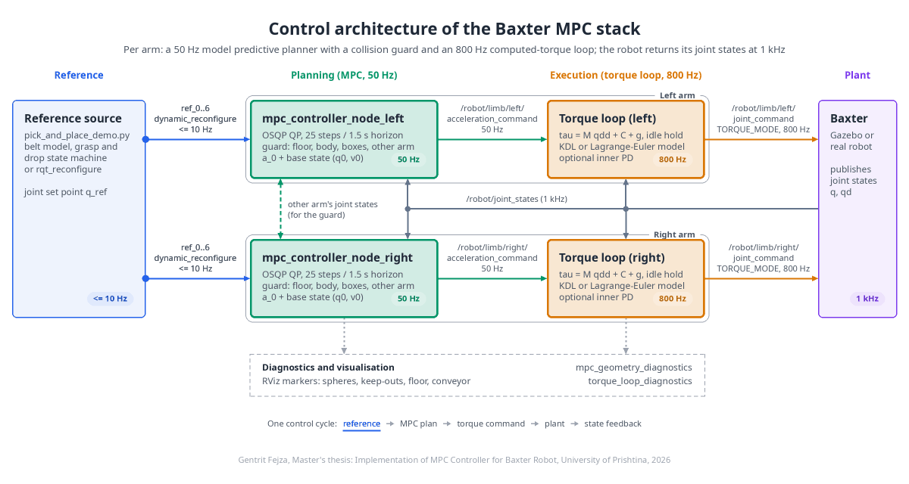
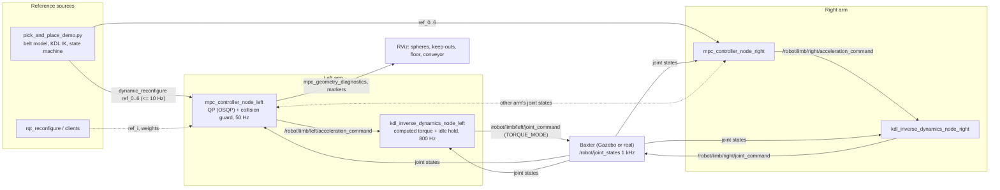
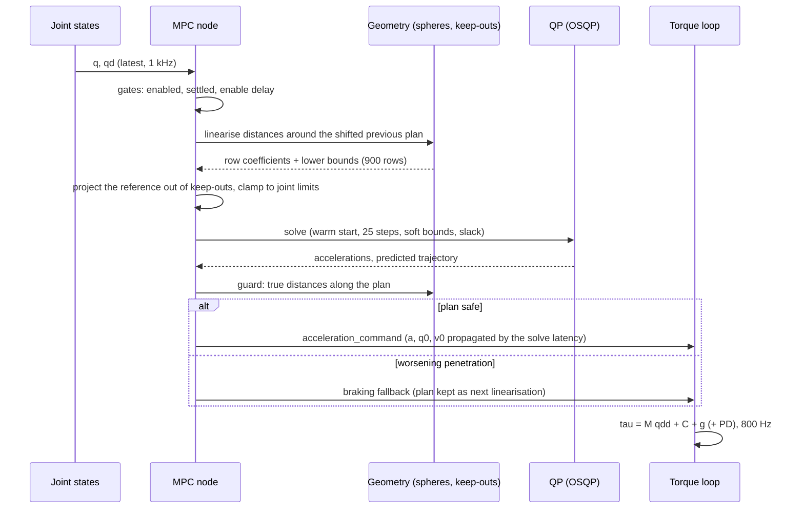

# Baxter MPC: model predictive control with a collision guard for conveyor pick-and-place

[](http://wiki.ros.org/noetic)
[](#)
[](#)
[](#)
[](#development)

A real-time control stack for the Rethink Baxter robot: a convex model predictive controller
(MPC) per arm that plans joint accelerations at 50 Hz under a **collision guard** (conveyor
floor, the robot's own body, the other arm), an 800 Hz **computed-torque loop** that turns the
plan into motor torques, and a two-arm **pick-and-place demo** on a moving conveyor belt,
validated in Gazebo and prepared for the real robot.

> **Master's thesis.** This software was developed by **Gentrit Fejza** for a Master's thesis
> at the **University of Prishtina**, Faculty of Electrical and Computer Engineering, programme
> *Electronics, Automation and Robotics* (2026). If you use this code, build on it, or quote
> its results, please credit the author and the thesis; see [Citation](#citation).

<p align="center">
  
</p>

## Contents

- [What it does](#what-it-does)
- [Architecture](#architecture)
- [Repository layout](#repository-layout)
- [Quick start](#quick-start)
- [Running](#running)
- [How the controller works](#how-the-controller-works)
- [Configuration](#configuration)
- [Results](#results)
- [Real robot](#real-robot)
- [Development](#development)
- [Design decisions](#design-decisions)
- [Citation](#citation)

## What it does

| Capability | Where | Rate |
|---|---|---|
| Joint-space MPC per arm: tracks a reference pose with joint position, velocity, acceleration and jerk limits, soft state bounds, braking fallback | `baxter_mpc_controller` | 50 Hz, ~12 ms per cycle |
| Collision guard inside the QP: conveyor floor, torso, head, pedestal, drop boxes and the other arm as linear rows on the predicted trajectory, plus a plan check that brakes instead of commanding an unsafe plan | `baxter_mpc_controller` | every MPC cycle |
| Computed-torque loop: `tau = M(q) qdd + C(q, qd) + g(q)` from the URDF (KDL) or from the author's own Lagrange-Euler derivation, optional inner PD, torque-space idle hold | `baxter_kdl_dynamics`, `baxter_dynamics` | 800 Hz, 0.07 ms per cycle |
| Two-arm pick-and-place on a moving belt: object prediction, grasp, carry, drop, continuous object supply | `scripts/pick_and_place_demo.py` | 20 Hz state machine |
| Simulation, validation scenarios, diagnostics recording and summaries, RViz visualisation of the guard | launch files and scripts | |

## Architecture

### Nodes and topics



### One MPC cycle



### Control law

```
reference pose q_ref  (dynamic_reconfigure, <= 10 Hz)
        |
   MPC node (50 Hz): min  sum_k |q_k - q_ref|^2_W + |a_k|^2_R + slack penalties
        |             s.t. double-integrator dynamics per joint, |a| <= a_max, |jerk| <= j_max,
        |                  soft position/velocity limits, geometry rows g^T q_k + s_k >= lb_k
        |            -> acceleration_command: a_0, q0, v0 (measured state propagated by the solve latency)
        |
   torque loop (800 Hz, KDL or Lagrange-Euler):
        |      qdd   = a_0 [+ Kp (q_ref(t) - q) + Kd (v_ref(t) - qd)],  q_ref(t) = q0 + v0 t + a_0 t^2/2
        |      tau   = M(q) qdd + C(q, qd) qd + g(q) [+ URDF damping compensation]
        |      idle  : tau = g(q) + Kp_hold (q_anchor - q) - Kd_hold qd   (no MPC reference yet)
        v
   /robot/limb/<side>/joint_command (TORQUE_MODE)
```

## Repository layout

| Path | Contents |
|---|---|
| `src/baxter_mpc_controller/` | MPC node (`mpc_controller*.cpp`), collision geometry (`arm_collision_model`, `collision_primitives`, `geometry_rows`, `geometry_markers`), other-arm listener, solver benchmark, launch files, configs, Gazebo models (`conveyor_ct6030`, `pick_cuboid`, `drop_box`), scripts, unit tests |
| `src/baxter_kdl_dynamics/` | URDF-based computed-torque loop (KDL), idle hold, diagnostics |
| `src/baxter_dynamics/` | The author's Lagrange-Euler dynamics of the 7-DOF arm from a DH model, verified against KDL; alternative torque-loop backend |
| `src/baxter_interface_cpp/` | C++ wrappers for the Baxter SDK limb and gripper topics |
| `src/baxter_kinematics/` | Tip forward kinematics and Jacobian helper |
| `src/baxter_simulator/`, `src/baxter_common/`, `src/baxter_interface/`, `src/baxter_tools/`, `src/baxter_examples/`, `src/baxter/` | Upstream Rethink Robotics packages (unchanged except the simulator's s1 effort limit) |
| `docker/` | CUDA-enabled ROS Noetic image and compose service used for everything below |
| `docs/` | The data-flow animation and the script that renders it |
| `Taskfile.yml` | One-line commands for building, simulating, validating and the demo |

## Quick start

Requirements: Docker with the NVIDIA runtime (for the Gazebo GUI; headless runs do not need
a GPU), [Task](https://taskfile.dev).

```bash
task docker:build      # build the image and compile the workspace
task run:demo          # Gazebo + RViz, both arms picking from the moving belt for 180 s
```

The terminal prints `Robot enabled; MPC commanding from the current pose` for both arms within
a few seconds and `DEMO RESULT` lines at the end. Gazebo's server crashes on roughly one launch
in four at start-up; if no window appears, run the task again.

## Running

### Pick-and-place demo

```bash
task run:demo                                  # GUI + RViz, 180 s, 6 cuboids, 0.05 m/s
task run:demo BELT_SPEED=0.08 OBJECTS=8 DURATION=300
task run:demo GUI=false RVIZ=false             # headless, only the log and DEMO RESULT lines
```

Equivalent inside the container: `roslaunch baxter_mpc_controller pick_and_place_demo.launch
[belt_speed:=0.05] [objects:=6] [duration:=180] [gui:=true] [rviz:=true] [inner_pd:=true]`.
The demo keeps the torque loops' inner PD on (a held cuboid is an unmodelled load); the
validation scenarios run pure feedforward.

### Validation scenarios

```bash
task run:validate                              # 20 clearance-checked random poses, tracking summary
task run:validate SCENARIO=floor               # reference below the belt: the arm must stop above it
task run:validate SCENARIO=torso               # reference inside the chest/head keep-out
task run:validate SCENARIO=belt                # pick-like pose above the belt, then below it
task run:validate SCENARIO=crossing BOTH_ARMS=true   # both arms sent to the same spot
task run:validate GUI=true RVIZ=true           # watch it, with the guard markers
```

Each run enables the robot, sends the home pose first (which arms the conveyor floor), then
the scenario poses, records synchronized diagnostics and prints settle times, final errors,
minimum clearances and guard statistics (`summarize_control_diagnostics.py`).

### Individual nodes

```bash
roslaunch baxter_mpc_controller mpc_controller.launch limb:=left        # MPC only
roslaunch baxter_kdl_dynamics kdl_inverse_dynamics.launch limb:=left   # torque loop only
roslaunch baxter_dynamics lagrange_euler.launch limb:=left             # Lagrange-Euler torque loop
roslaunch baxter_mpc_controller mpc_solver_benchmark.launch geometry:=true   # solver timing
rqt_reconfigure                                                        # ref_i, pos_weight_i, accel_weight_i
```

`baxter_mpc.launch dynamics_backend:=lagrange_euler` swaps the torque loop for the
Lagrange-Euler backend in the full simulation stack.

## How the controller works

### MPC

- Decoupled double integrator per joint, 25 steps over 1.5 s (first step = one control period,
  the rest spread evenly; the horizon covers a full stop from the velocity limit), 12 control
  steps. Convex QP solved by OSQP through CasADi, warm started; `qpoases` and `ipopt` backends
  and a time-scaling (minimum-time) formulation exist for experiments.
- Position and velocity limits are soft (one quadratic slack per joint and step), so a measured
  state outside the limits (impact, overspeed) never makes the QP infeasible; acceleration and
  jerk limits are hard.
- The base state `(q0, v0)` sent with each acceleration is propagated through the MPC's own
  solve latency, so the torque loop's reference never lags the plant. A late solution is still
  commanded (late beats a torque-loop timeout into position mode); a failed solve commands a
  braking acceleration instead of nothing.
- Start-up: the node idles until the robot reports enabled, until every joint has been slower
  than `settle_velocity_rad_s` for `settle_hold_sec`, and for `enable_delay_sec`; the first
  solve is repeated on its own iterate until it converges; a solve that stalls at the iteration
  cap right after converged ones is retried once from zero duals; joint velocities beyond
  `overspeed_ratio` times the bound trigger braking until the arm is back in range. Until a
  client sets a reference the node holds the pose measured at enable time.

### Collision guard

- Each arm is 12 spheres (3 upper arm, elbow, 3 forearm, wrist pitch, 2 wrist, hand, gripper
  with its bottom at the fingertips) defined in `config/collision_geometry.yaml`; the body is
  a torso box, the two URDF head spheres and the pedestal column; the conveyor is the plane
  `z = z_min`; the other arm is its sphere chain at its measured joints, extrapolated at its
  measured velocity for `other_arm.extrapolation_sec`.
- Every cycle the signed surface distances are linearised around the previous predicted
  trajectory (shifted one step) and enter the QP as `g^T q_k + s_k >= margin - d + g^T q_bar`
  with a quadratic slack per sphere and step. Inactive rows (farther than
  `activation_distance`) get zero coefficients and `-inf` bounds, so the QP sparsity never
  changes. Margins grow with the step's time into the horizon (`margin_growth_per_sec`).
- A reference inside a keep-out (a pick pose below the floor margin, a drop pose inside the
  head margin) is first moved out along the row gradients (`project_reference`) and clamped
  to the joint limits, so the MPC tracks a reachable set point; without this the constant pull
  into the constraint made OSQP hit its iteration cap every cycle and the arm chattered.
- After the solve, the true distances along the predicted trajectory are checked. A predicted
  distance below `guard.margin` that also takes the arm deeper into that obstacle than it is
  now rejects the plan: the arm brakes and the rejected plan stays the next cycle's
  linearisation trajectory, so the rows around it shape the next plan. The rule is per
  obstacle, so an arm climbing out of a keep-out is never blocked by one sphere dipping 1 cm.
- The conveyor floor is armed when the arm first reaches the home pose (the real robot starts
  there; the simulated rest pose hangs the fingertips 0.73 m below the base, under the belt).

### Torque loop

- `baxter_kdl_dynamics` builds the KDL chain from the live URDF (`torso -> <side>_gripper_base`),
  lumps the fixed-joint subtree beyond the tip into the tip inertia, and computes
  `tau = M qdd + C qd + g` plus compensation of the URDF viscous damping. In Gazebo the
  inner PD is off (the plant is the model itself, and the MPC re-plans from the measured state
  at 50 Hz); on the real robot it is on.
- Whenever it has no (or a stale) MPC acceleration reference, the loop holds the pose in torque
  mode with gravity compensation plus a torque-space PD per joint (`hold_kp` in Nm/rad,
  `hold_kd` in Nm s/rad), anchored where the hold engaged and re-anchored when a joint jumps by
  more than `teleport_jump_rad` between samples (a simulator reset). Holding in torque mode
  moves the simulator's position-to-torque hand-over to the enable instant, while the MPC still
  idles. The PD must act in torque space: an acceleration-space PD scaled by the inertia gave
  the simulated wrists only 0.6 Nm/rad, too little to pull a joint off a limit stop.
- `baxter_dynamics` is the author's closed-form Lagrange-Euler model from DH parameters
  (pseudo-inertia matrices, `U_ij` and `U_ijk` derivative matrices); its `M`, `C` and `g` match
  KDL built from the URDF to about 1e-3 (`lagrange_euler_kdl.test`). Link 7 lumps wrist, hand
  and gripper. The electric gripper finger links in the stock URDF carry `0.01 kg m^2` inertias
  (about 1000x too large); do not "fix" them for simulation, with realistic values the simulated
  w2 no longer tracks because ODE damping and stop friction dominate.

### Simulator notes

- Gazebo's ros_control enforces the URDF joint velocity limits (1.5 rad/s shoulders and elbows,
  4 rad/s wrists) by zeroing the effort in one direction, so the MPC keeps its own velocity
  bounds at 80 % of those limits and penalises velocity slightly.
- The simulator's Baxter emulator switches gravity off on the arm links (to emulate the real
  robot's built-in gravity compensation) through `/gazebo/set_link_properties`, and that call
  races with the robot spawn. When it wins, the arms are weightless while the torque loop adds
  full gravity compensation and both arms drift up at a steady rate until the elbows hit their
  stops. `scripts/enforce_arm_gravity.py`, started by `baxter_mpc.launch`, turns gravity back on
  for the arm links during the first 40 s, so the simulated plant always matches the model.
- `set_model_configuration` (teleporting joints) is unreliable while controllers run; the demo
  therefore lets the MPC drive the arms from the rest pose to home (`--teleport-home` keeps the
  old behaviour).

### Pick-and-place demo

`pick_and_place_demo.launch` spawns the CT6030 conveyor (1500 x 250 x 750 mm, 190 mm belt),
two drop boxes behind the shoulder line at base-frame `(-0.10, +/-0.90)` and `objects`
cuboids (30 x 30 x 100 mm) that the script drives along the belt at `belt_speed` through the
model-state interface (the belt model is static). Each arm runs a state machine: claim the next
object entering its zone, hover above its predicted position (constant-velocity lead), descend,
close, lift (a slipped grasp is detected and the object handed back), carry through a via point
beside the shoulder, drop, release, return home. Placed cuboids re-enter the belt at its start
as soon as there is one spacing of room, so the supply never stops. Joint references come from
a KDL Levenberg-Marquardt IK in the script, seeded from the current joints; for the carry and
drop poses several gripper orientations are tried and the one whose arm pose keeps the most
clearance from the body keep-outs wins (evaluated with the guard's own spheres and primitives,
read from the parameter server). References reach the MPC through dynamic reconfigure,
rate-limited to 10 Hz and change-gated. `config/collision_geometry_demo.yaml` adds the boxes to
the keep-outs; the demo launch lowers `floor_margin` to 0.025 m so the fingertips reach the
cuboids.

## Configuration

All keys live under `robot/` on the parameter server. The main ones (full lists with comments
in the YAML files):

| Key | Meaning |
|---|---|
| `robot.solver_mode`, `robot.solver_backend` | `qc` (quadratic cost, default) or `time_scaling`; `osqp` (default), `qpoases`, `ipopt` |
| `robot.solver.osqp.{eps_abs,eps_rel,max_iter,rho,adaptive_rho,adaptive_rho_interval}` | OSQP settings; `eps 5e-4`, `max_iter 250` (capped iterates are used when feasible) |
| `robot.solver.{soft_state_bounds,slack_quadratic_weight,velocity_weight_ratio}` | soft joint bounds; keep the linear slack weight at 0 (an L1 term stalls OSQP) |
| `robot.control.{mpc_rate_hz,prediction_duration_sec,prediction_horizon,control_horizon,cycle_deadline_ms}` | horizon and timing |
| `robot.control.{require_enabled,settle_velocity_rad_s,settle_hold_sec,enable_delay_sec,first_solve_max_retries,overspeed_ratio,braking_fallback}` | start-up and recovery |
| `robot.{acceleration_max,acceleration_min,jerk_max,jerk_min}` | hard limits per joint |
| `robot.geometry.enabled`, `z_min` | guard on/off; conveyor surface height in the base frame (CT6030: -0.18 m) |
| `robot.geometry.{floor_margin,body_margin,arm_margin,activation_distance,margin_growth_per_sec,project_reference}` | margins (surface to surface) and row activation |
| `robot.geometry.rows_per_sphere.{floor,body,other_arm}`, `step_stride`, `slack_quadratic_weight` | QP size and slack weight (1e6; write it as `1000000.0`, `1.0e6` is a string to rosparam) |
| `robot.geometry.guard.{mode,margin,worsening_tolerance}` | `reject` (default), `warn`, `off` |
| `robot.geometry.other_arm.{required,timeout_sec,extrapolation_sec}` | other-arm state handling |
| `robot.geometry.floor.{activate_at_home,home_tolerance_rad,home_position}` | floor arming |
| `robot.geometry.conveyor.{enabled,x,y,yaw,length,width,belt_width,height}` | conveyor drawn in RViz and spawned in Gazebo |
| `robot.collision_geometry.{arm_spheres,body}` | sphere and primitive definitions (`collision_geometry.yaml`) |
| `robot.kdl_dynamics.{add_gravity_compensation,compensate_urdf_damping,kp,kd,extrapolate_reference}` | torque loop |
| `robot.kdl_dynamics.{hold_when_idle,hold_mode,hold_kp,hold_kd,teleport_jump_rad}` | idle hold |
| `robot.lagrange_euler.{kp,kd,extrapolate_reference}`, `robot.limb.*`, `robot.torque_limits.*` | Lagrange-Euler backend and its DH model (`dynamics_params.yaml`) |

Dynamic reconfigure on each MPC node: `ref_0..6` (target joint angles), `pos_weight_0..6`,
`accel_weight_0..6`.

## Results

All numbers from Gazebo (headless or GUI), recorded with `record_control_diagnostics.py` and
summarised with `summarize_control_diagnostics.py`.

| Experiment | Result |
|---|---|
| 20-pose tracking regression without the guard | 20/20 settled within 0.02 rad, mean final error 1e-4 rad, median settle 2.3 s, no torque saturation (baseline before the work: 18/50) |
| 20-pose regression with the guard and the conveyor | 18/21 settled to 1e-4 rad (two references inside a keep-out park at the margin), body clearance never below the margin, 0 guard rejections, cycle median 11 ms |
| Floor scenario (reference 0.55 m below the belt) | fingertips come to rest 2.7 to 3.5 cm above the belt, three of three runs |
| Belt scenario (pick pose 0.059 m above the belt, then below) | pick pose settled in 1.0 s, then rests at the belt limit |
| Torso scenario | parks 0.044 m from the chest/head keep-out |
| Crossing arms (both sent to the same spot) | both arms home, kept apart at the margin, 0.08 m minimum distance |
| Pick-and-place demo, 180 s, belt 0.05 m/s, six cuboids (`task run:demo`, inner PD on) | **38 placed, 1 missed grasp**, 0 guard rejections, 0 velocity recoveries, MPC in control 3 s after launch, ~8 s per pick-and-place cycle per arm, drop in 1.1 s |
| Same demo with pure feedforward torque (`inner_pd:=false`) | 35 placed, 6 missed (two 90 s headless runs: 17/2 off vs 17/1 on); the demo launch therefore keeps the PD on |

MPC cycle time with the 900 geometry rows: median 11 to 12 ms, p90 14 to 30 ms; about 3 % of
cycles exceed the 20 ms deadline and are commanded late. Without the guard: 3 to 5 ms.

## Real robot

```bash
export ROS_MASTER_URI=http://<baxter>:11311 ROS_IP=<this machine>
roslaunch baxter_mpc_controller baxter_mpc_real.launch        # both arms, enables the robot
```

Compared with the simulation launch, `baxter_mpc_real.launch`:
- adds **no gravity compensation in the torque loop**: the real Baxter adds its own gravity
  compensation torques in torque mode (`add_gravity_compensation:=false`), while the simulated
  joints carry gravity themselves;
- keeps the URDF s1 effort limit of 50 Nm (the simulator submodule raises it to 100 Nm only
  because the simulated joint carries gravity);
- turns the computed-torque inner PD on (the model is approximate on hardware);
- starts no simulator helpers (no gravity work-around, no simulated enable script).

The robot must start in its untucked home pose (`rosrun baxter_tools tuck_arms.py -u`), which
arms the conveyor floor. Measure the belt height and position on site and pass
`z_min`, `conveyor_x`, `conveyor_y`, `conveyor_yaw`. The collision guard has only been validated
in simulation: start with `task run:validate`-style single poses at low speed, keep the e-stop
within reach, and run the demo only after the clearances in RViz look right.

## Development

```bash
task docker:up && task docker:shell
catkin_make                                        # inside the container, /workspace
catkin_make run_tests_baxter_mpc_controller && catkin_test_results build/test_results
catkin_make run_tests_baxter_dynamics              # Lagrange-Euler vs KDL
```

Unit tests (45): collision primitives (analytic distances, gradients against finite
differences), the sphere model against KDL forward kinematics and Jacobians, the row
linearisation algebra, and the QP with geometry rows (inactive rows reproduce the plain
controller, an active floor row is respected, an unsatisfiable row uses slack, bad batches are
rejected). Doxygen comments in every header describe the classes, units and equations;
`doxygen` with a default `Doxyfile` over `src/baxter_*` renders them.

Workflow notes: both containers (`mpc_baxter_robot_dev` with GPU and X11, `mpc_baxter_validate`)
share the repository mount at `/workspace`, so only one Gazebo at a time; give GUI processes
`__NV_PRIME_RENDER_OFFLOAD=1 __GLX_VENDOR_LIBRARY_NAME=nvidia` to render on the NVIDIA GPU;
`validation/*.txt` are JSON-lines diagnostics logs.

## Design decisions

- **Why a convex QP and not a nonlinear MPC.** The decoupled double-integrator model with the
  computed-torque loop underneath makes the per-arm problem a QP that OSQP solves in a few
  milliseconds warm-started; the collision constraints are linearised around the previous plan
  and re-linearised every cycle, which keeps the problem convex and always feasible (slack).
- **Why KDL and not Pinocchio.** The MPC does not use the full dynamics (the torque loop does),
  and the torque loop computes `M`, `C`, `g` in 0.07 ms at 800 Hz with KDL. Pinocchio would be
  worth it for a full nonlinear MPC with analytical derivatives, not for this architecture.
- **Why two dynamics backends.** The Lagrange-Euler derivation is the thesis' own model and is
  verified against KDL; KDL is the default because it is built from the live URDF of whichever
  robot is connected.
- **Why the guard is soft constraints plus a check.** Soft rows keep the QP feasible under any
  measured state; the explicit plan check catches linearisation error on fast motions and only
  brakes when a plan would make a penetration worse, so an arm that starts inside a margin can
  always move out.

## Citation

Please cite the thesis when you use this work (see also `CITATION.cff`):

```bibtex
@mastersthesis{Fejza2026BaxterMPC,
  author  = {Gentrit Fejza},
  title   = {Model Predictive Control with Collision Avoidance for the Baxter Robot on a Conveyor Pick-and-Place Task},
  school  = {University of Prishtina, Faculty of Electrical and Computer Engineering, Electronics, Automation and Robotics},
  year    = {2026},
  address = {Prishtina},
  note    = {Software: \url{https://github.com/gentritfejza-up/mpc_baxter_robot}}
}
```

Upstream components: Rethink Robotics' Baxter SDK and simulator packages (`src/baxter_*`
submodules), CasADi, OSQP, KDL, ROS Noetic.
